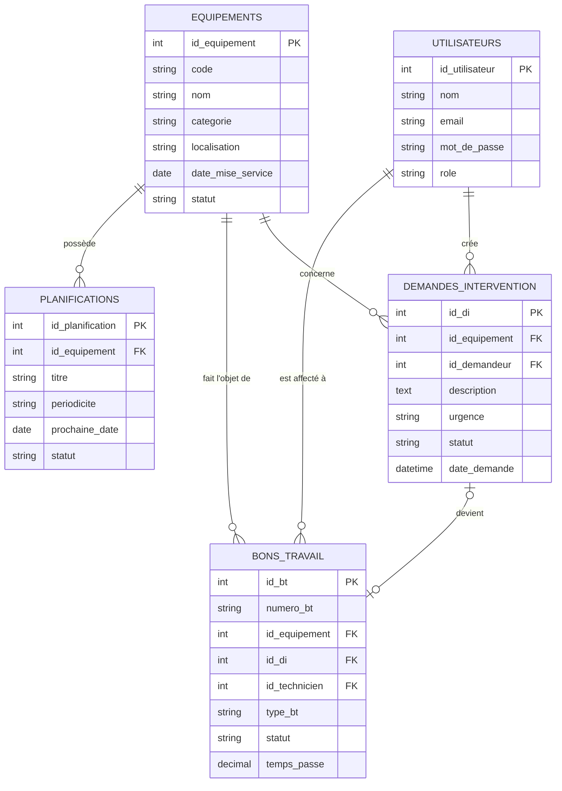

# Modèle de données - Mini-GMAO

## MCD simplifié

## Règles de gestion principales

1. Un opérateur peut créer une ou plusieurs demandes d'intervention.
2. Une demande concerne un seul équipement.
3. Le responsable valide une demande et crée un bon de travail correctif.
4. Un BT est affecté à un seul technicien, mais un technicien peut avoir plusieurs BT.
5. Le statut d'un BT suit l'ordre : Créé, Assigné, En cours, Clôturé.
6. Pour clôturer, le technicien indique le temps passé, la cause et les tâches réalisées.
7. Un équipement possède zéro ou plusieurs planifications préventives.
